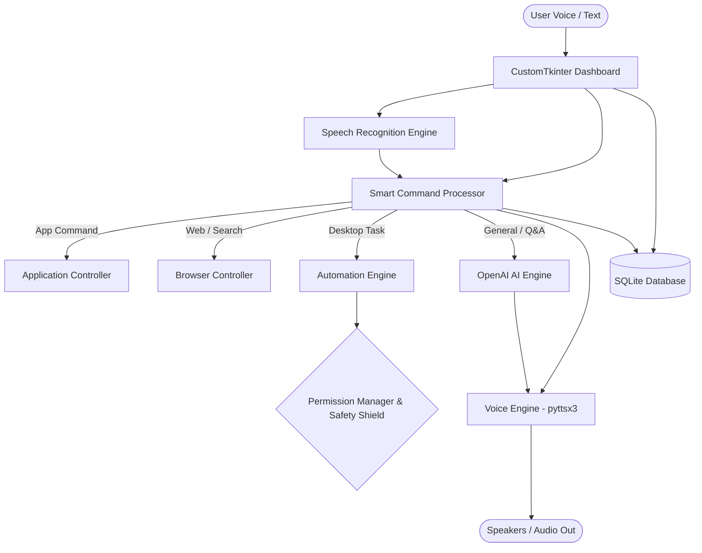

# JARVIS Architecture & Engineering Specification

## 1. Architectural Philosophy
JARVIS is designed around a multi-tier, decoupled, event-driven architecture that separates the user interface, intent processing, voice subsystem, AI inference, and operating system automation.

## 2. Component Breakdown

### 2.1 Frontend Tier (`frontend/`)
- **`dashboard.py`**: Central HUD containing the real-time audio visualizer, top navigation bar, system telemetry cards, quick command shortcuts, and neural message stream.
- **`voice_visualizer.py`**: Multi-harmonic mathematical sine/cosine animated wave on a high-frequency canvas reflecting active states: `IDLE`, `LISTENING`, `PROCESSING`, and `SPEAKING`.
- **`chat_interface.py`**: Scrollable, non-blocking conversational view with timestamped message bubbles and intent tags.
- **`settings.py`**: Tabbed configuration suite allowing real-time modification of OpenAI credentials, model selection, speech synthesis rate/volume, and safety automation policies.
- **`components.py`**: Reusable design tokens, glassmorphism cards, glowing status pills, and interactive buttons.

### 2.2 Backend Tier (`backend/`)
- **`command_processor.py`**: Modular intent classifier and router that evaluates queries against regular expressions for low-latency native execution and routes conversational queries to the LLM.
- **`speech_recognition.py`**: Speech-to-text pipeline utilizing `SpeechRecognition` and `PyAudio` with ambient noise calibration and asynchronous listening threads.
- **`voice_engine.py`**: Dedicated background thread and queue-based text-to-speech system using `pyttsx3` (with optional `gTTS` fallback) ensuring zero UI freeze.
- **`ai_engine.py`**: OpenAI API connector maintaining session history context, connection health checks, and graceful offline fallback messaging.
- **`application_controller.py`**: Secure application launcher validating target aliases against approved system executables.
- **`browser_controller.py`**: URL safety validator and search engine launcher for Google and YouTube.
- **`automation_engine.py`**: Keyboard and mouse automation powered by PyAutoGUI with fail-safe boundaries, authorization prompts, and immediate emergency halt capabilities.

### 2.3 Database Tier (`database/`)
- **`db_manager.py`**: SQLite database managing tables for:
  - `conversations`: Conversation sessions and timestamps.
  - `messages`: Full message history with sender and intent tags.
  - `settings`: Persistent key-value configuration.
  - `automation_logs`: Security audit log recording every automated action.

### 2.4 Safety & Utilities (`utils/`)
- **`config.py`**: Pydantic-based configuration model with `.env` file synchronizer.
- **`logger.py`**: Rotating file handler with built-in regex sanitizers that redact API keys and bearer tokens from logs.
- **`permissions.py`**: Whitelist registry and emergency stop state coordinator.
- **`helpers.py`**: Telemetry diagnostic tools (CPU, RAM, Battery, Time) and Windows virtual environment runtime configurator.

